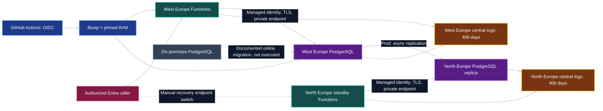
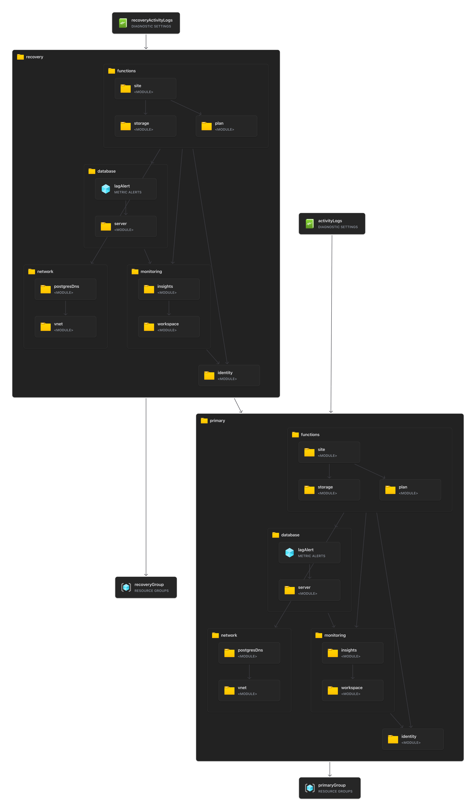
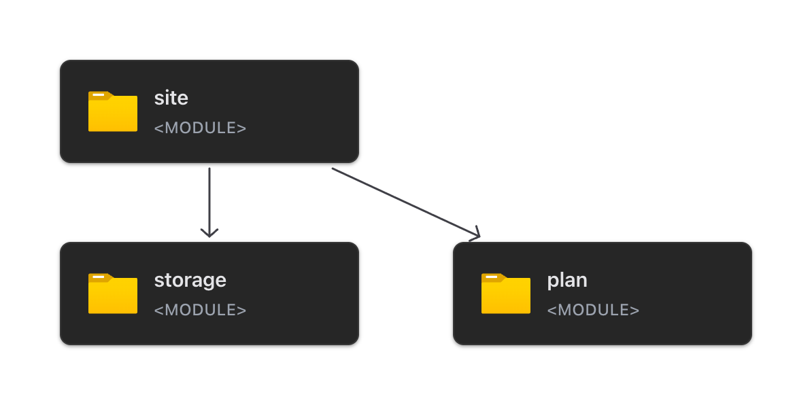

# NovaBank: a small, repeatable first cloud step

## Context and recommendation

NovaBank operates one on-premises API VM, PostgreSQL, local logs, and no environment separation. Regulated EU operations require better auditability, repeatability and recoverability. Start with separate Azure dev/prod resource groups, a deliberately tiny .NET isolated Functions API, managed PostgreSQL, and centrally retained logs.

The demo proves host health and database connectivity only. It does not implement a customer portal, expose customer records, migrate production data, or certify production readiness.

## Architecture

The diagram below shows the logical architecture; the Bicep IaC views that follow show what gets deployed.

### What gets deployed: Bicep IaC

**Complete deployment:** the [full Bicep visualization](../images/complete.png) shows the primary and recovery resource groups, Functions, PostgreSQL, networking, managed identities, monitoring, and Activity Log diagnostic settings. This is the infrastructure defined for deployment, not evidence of a successful Azure deployment.

**Functions detail:** the [Functions Bicep visualization](../images/functions.png) expands the compute module into the function app (`site`), runtime storage (`storage`), and hosting plan (`plan`) that get deployed together.

## Decisions and trade-offs

- **Functions Flex Consumption, .NET 10 isolated:** no VM management; API-only autoscaling. Start with 512 MB, HTTP concurrency 4, a maximum of 40 on-demand instances, and a database pool of 5 per process. Primary prod has two always-ready HTTP instances and zone redundancy; dev and the recovery app scale to zero. Always-ready capacity is additional to the on-demand limit. Measure memory, latency, connections, and load before increasing capacity.
- **PostgreSQL Flexible Server:** dev uses `Standard_B1ms`; prod uses two-vCore `Standard_D2ds_v5` General Purpose, a zone-redundant primary/standby, and a matching read replica. Burstable is unsuitable for production HA/read replication. The replica adds cost but is needed for the chosen regional recovery design.
- **West Europe and North Europe only:** parameter allowlists intentionally restrict this starter deployment to a distinct EU pair. LRS/ZRS regional storage and disabled geo-redundant database backups avoid unvalidated replication locations. Both regions have their own runtime storage, network, identity and logging.
- **Identity and network boundaries:** passwordless PostgreSQL and storage; Entra-authenticated API; private runtime database connectivity; default-deny storage network ACLs. Hosted runners need narrow temporary public access exceptions. These are explicit demo compromises; private deployment connectivity is the production next step.
- **Auditability:** each region has a workspace with 400-day retention, Application Insights, resource diagnostics and a subscription Activity Log export. Only configured security/platform groups receive workspace reader roles. Existing inherited administrative access is not removed. Activity Log exports contain subscription-wide management metadata and are duplicated; factor that into authorization and cost.
- **Delivery:** AVM-backed Bicep, environment parameters, credential-free PR checks and manual OIDC deployment. No automatic resource deletion or failover. Database access bootstrap is idempotent and checks existing principal object IDs.

## Targets and outstanding evidence

Production objectives are availability >=99.9%, RPO <=1 hour and RTO <=4 hours. Zone resilience, backups, a second-region replica and a provisioned standby API address these objectives, but do not prove them. Async replica lag can exceed one hour; a 900-second alert provides response headroom, not a guarantee. Prove workload fit, actual service SLAs, migration lag, primary failure handling, promotion, identity access after promotion, client endpoint switching and recovery duration before accepting the design.

There is no global routing service in this small PoC. Recovery is an approved manual endpoint switch. The secondary API can read the replica before promotion but cannot make the database writable.

Indicative monthly totals are **about USD 35 dev and USD 550 prod, NOT VERIFIED**; see the [cost model](costs.md) for retrieved unit rates and explicit assumptions. Production database HA/replication dominates spend. Do not remove required redundancy merely to match dev cost.

## Next steps and delivery alignment

Validate the subscription deployment and logging, rehearse [migration and recovery](migration-and-recovery.md), establish operations ownership and incident response, replace hosted-runner exceptions, and load-test before onboarding real data. Add the assessment's AI helper and presentation as separate work, using only reviewed synthetic inputs and an EU endpoint.

Use the [CloudNation 6D model](https://www.cloudnation.nl/en/inspiration/blogs/moving-to-the-cloud-how-to-structure-a-successful-migration) to connect discovery, a bounded demonstration and an evidence-based next step; this document does not reproduce the model.
